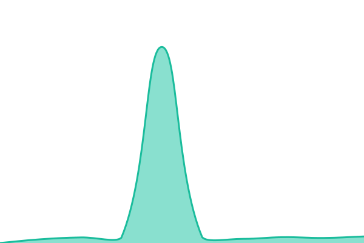

# [📈 Live Status](https://status.biblivre.cloud): <!--live status--> **🟩 All systems operational**

This repository contains the open-source uptime monitor and status page for [Upptime](https://upptime.js.org), powered by [Upptime](https://github.com/upptime/upptime).

With [Upptime](https://upptime.js.org), you can get your own unlimited and free uptime monitor and status page, powered entirely by a GitHub repository. We use [Issues](https://github.com/upptime/upptime/issues) as incident reports, [Actions](https://github.com/upptime/upptime/actions) as uptime monitors, and [Pages](https://status.biblivre.cloud) for the status page.

<!--start: status pages-->
<!-- This summary is generated by Upptime (https://github.com/upptime/upptime) -->
<!-- Do not edit this manually, your changes will be overwritten -->
<!-- prettier-ignore -->
| URL | Status | History | Response Time | Uptime |
| --- | ------ | ------- | ------------- | ------ |
|  [Biblivre Baixada Literária](https://baixadaliteraria.biblivre.cloud) | 🟩 Up | [biblivre-baixada-literaria.yml](https://github.com/cleydyr/biblivre-cloud-upptime/commits/HEAD/history/biblivre-baixada-literaria.yml) | 

 2327ms
     
 | 

<a href="https://status.biblivre.cloud/history/biblivre-baixada-literaria">100.00%</a>
    

|  [Releitura Pernambuco](https://releiturape.biblivre.cloud) | 🟩 Up | [releitura-pernambuco.yml](https://github.com/cleydyr/biblivre-cloud-upptime/commits/HEAD/history/releitura-pernambuco.yml) | 

 2451ms
     
 | 

<a href="https://status.biblivre.cloud/history/releitura-pernambuco">100.00%</a>
    

|  [Biblioteca Municipal Celso Brant](https://trespontas.biblivre.cloud) | 🟩 Up | [biblioteca-municipal-celso-brant.yml](https://github.com/cleydyr/biblivre-cloud-upptime/commits/HEAD/history/biblioteca-municipal-celso-brant.yml) | 

 1021ms
     
 | 

<a href="https://status.biblivre.cloud/history/biblioteca-municipal-celso-brant">97.93%</a>
    

|  [Associação São Roque](https://associacaosaoroque.biblivre.cloud) | 🟩 Up | [associacao-sao-roque.yml](https://github.com/cleydyr/biblivre-cloud-upptime/commits/HEAD/history/associacao-sao-roque.yml) | 

 2751ms
     
 | 

<a href="https://status.biblivre.cloud/history/associacao-sao-roque">97.95%</a>
    

|  [Instituto Luzia Basílio](https://institutoluziabasilio.biblivre.cloud/) | 🟩 Up | [instituto-luzia-basilio.yml](https://github.com/cleydyr/biblivre-cloud-upptime/commits/HEAD/history/instituto-luzia-basilio.yml) | 

 674ms
     
 | 

<a href="https://status.biblivre.cloud/history/instituto-luzia-basilio">100.00%</a>
    

|  [LGA](https://lga.biblivre.cloud) | 🟩 Up | [lga.yml](https://github.com/cleydyr/biblivre-cloud-upptime/commits/HEAD/history/lga.yml) | 

 446ms
     
 | 

<a href="https://status.biblivre.cloud/history/lga">100.00%</a>
    

|  [GBA](https://gba.biblivre.cloud) | 🟩 Up | [gba.yml](https://github.com/cleydyr/biblivre-cloud-upptime/commits/HEAD/history/gba.yml) | 

 439ms
     
 | 

<a href="https://status.biblivre.cloud/history/gba">99.63%</a>
    

|  [Biblioteca Casa Amarela](https://casaamarela.biblivre.cloud) | 🟩 Up | [biblioteca-casa-amarela.yml](https://github.com/cleydyr/biblivre-cloud-upptime/commits/HEAD/history/biblioteca-casa-amarela.yml) | 

 640ms
     
 | 

<a href="https://status.biblivre.cloud/history/biblioteca-casa-amarela">97.96%</a>
    

<!--end: status pages-->

[**Visit our status website →**](https://status.biblivre.cloud)

## 📄 License

- Powered by: [Upptime](https://github.com/upptime/upptime)
- Code: [MIT](./LICENSE) © [Anand Chowdhary](https://anandchowdhary.com)
- Data in the `./history` directory: [Open Database License](https://opendatacommons.org/licenses/odbl/1-0/)
